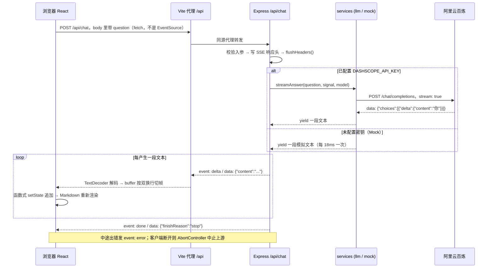

# 流式 AI 聊天应用 · Node + Express + SSE + React

一个可以**直接跑起来**的 AI 对话项目：浏览器提问 → Node 后端转发给阿里云百炼 → 模型回答通过 **SSE 流式**逐段返回 → React 边收边渲染 Markdown。

面向「用过 AI 问答、但没完整做过一个前后端项目」的开发者。代码按模块拆开、每个文件只做一件事、关键处都写了中文注释。

> 没有 API Key 也能跑：后端会自动进入 **Mock 模式**，逐字吐出一段带 Markdown 的示例回答，方便先验证整条链路。

---

## 一、5 分钟跑起来

**环境**：业务代码需要 Node.js **18+**（用到内置 `fetch`、`AbortController`、`node --watch`，Vite 5 也要求 18+）。但**启动脚本兼容旧版 Node**：`npm run dev` 会自动在本机寻找 Node 18+ 来运行前后端，所以即使终端里 `node -v` 显示 `v14.x`，也能直接启动，不必先折腾环境。

```powershell
# 先进入项目根目录（能同时看到 package.json 和 README.md 的那一层）
npm run install:all     # 依次安装 根目录 / server / client 三处依赖
npm run dev             # 启动器自动选版，并行拉起后端 3001 与前端 5173
```

启动器逻辑在 `scripts/dev.mjs`：它只做进程编排，会检查 PATH、nvm 以及本机自带的高版本 Node 运行时，找到第一个 ≥18 的就使用它，并在终端打印实际版本号。若本机确实一个都没有，会给出中文提示，此时任选一种：安装 [Node 20 LTS](https://nodejs.org/)（推荐）、用 nvm-windows 执行 `nvm install 20` / `nvm use 20`，或指定已有运行时 `$env:NODE_BINARY = "C:\path\to\node.exe"` 后再启动。

浏览器打开 <http://localhost:5173>，随便问一句（或点空状态里的示例卡片），即可看到逐段到达的回答。

**接真实模型**（可选）：

```powershell
Copy-Item server/.env.example server/.env   # macOS/Linux 用 cp server/.env.example server/.env
notepad server\.env                          # 填入 DASHSCOPE_API_KEY=sk-你的密钥
```

保存后 `node --watch` 会自动重启后端，右上角徽标从「模拟模式」变成「百炼在线」。**前端一行代码都不用改。**

单独启动某个端：`npm run dev:server`、`npm run dev:client`。

还有一条自检命令 `npm run smoke`：它会自己启动后端，检查健康检查、参数校验、SSE 响应头、帧格式以及增量文本能否拼回完整回答；同时用一个**本地假百炼服务**验证真实模式的请求头与流式拆帧。全程不联网、不消耗任何真实额度，跑完自动关闭所有进程。改完代码后跑一下，能快速确认两条链路都没被改坏。

---

## 二、项目结构与模块职责

```
AITestProject/
├── package.json                 根工程：只负责编排进程（install:all / dev），不含业务代码
├── .gitignore                   排除 node_modules、dist 和所有 .env
├── README.md                    本文件
├── scripts/
│   ├── dev.mjs                  启动器：自动挑选 Node 18+ 并并行拉起前后端
│   └── smoke-test.mjs           端到端冒烟测试（Mock 与真实模式两条链路）
├── server/
│   ├── package.json             express / dotenv / cors 三个运行时依赖
│   ├── .env.example             配置模板（入库），真实 .env（不入库）
│   └── src/
│       ├── app.js               Express 装配：安全头、CORS、JSON 解析、健康检查、路由
│       ├── config.js            唯一读取环境变量的地方，判定 real / mock 模式
│       ├── routes/chat.js       POST /api/chat：校验、SSE 响应头、逐帧下发、断连清理
│       ├── services/
│       │   ├── index.js         策略门面：选出「真实模型」还是「Mock」
│       │   ├── llm.js           调用百炼 OpenAI 兼容接口 + 解析上游 SSE
│       │   └── mockStream.js    无密钥时的逐字模拟流
│       └── utils/sse.js         后端 SSE 工具：写帧 + 增量帧解析器
└── client/
    ├── package.json             react / react-dom / react-markdown / remark-gfm / vite
    ├── vite.config.js           dev server，把 /api 代理到 127.0.0.1:3001
    ├── index.html               Vite 入口
    └── src/
        ├── main.jsx             React 挂载
        ├── App.jsx              页面骨架 + 消息状态编排（发送 / 追加 / 完成 / 出错）
        ├── api/chatStream.js    发请求 + 读流 + 分发帧事件（前端唯一的通信入口）
        ├── utils/sse.js         前端增量帧解析器
        ├── components/
        │   ├── ChatWindow.jsx   消息列表、空状态示例卡片、自动滚动
        │   ├── MessageItem.jsx  气泡 + Markdown 渲染 + 流式光标 + 错误提示
        │   ├── ModelSelect.jsx  自定义模型下拉（避开原生 select 的系统弹出层样式）
        │   └── ChatInput.jsx    输入区（回车发送 / Shift+Enter 换行）
        └── styles/index.css     全部样式：玻璃卡片、气泡、Markdown 排版、响应式
```

**分层思路**：表现层 → 通信层 → 接入层 → 领域层 → 外部服务。数据单向流动：问题往下走，增量文本往上走。

---

## 三、前后端通信流程

最重要的一点：**这里有两条互相独立的 SSE 连接**。

1. **上游**：`百炼 → 后端`。后端用 `fetch` 请求百炼，百炼以 SSE 帧不断吐出增量文本。
2. **下游**：`后端 → 浏览器`。后端把上游片段「翻译」成自己的帧协议，再写给浏览器。

后端做协议适配，前端永远不直连模型，**密钥也永远不会下发到浏览器**。



逐步文字版：

1. 用户输入问题，`App.jsx` 立刻插入两条消息：用户气泡，和一条**内容为空、状态为 `streaming`** 的助手气泡。
2. `chatStream.js` 用 `fetch('/api/chat', { method: 'POST' })` 发请求，Vite 代理转发到 Express。
3. `routes/chat.js` 校验 `question`，写 SSE 响应头并 `flushHeaders()`，连接就此保持打开。
4. `services/index.js` 选出的生成器每 `yield` 一段文本，路由就写一个 `event: delta` 帧。
5. 浏览器 `getReader()` 读到字节，解析器切出帧，`onDelta` 把文本追加到最后一条助手消息。
6. 生成结束写 `event: done`，后端 `res.end()`；前端清除光标、恢复输入框可用。

---

## 四、SSE 接口设计

### 4.1 为什么是 POST？为什么不用 `EventSource`？

| | `EventSource` | `fetch` + `ReadableStream`（本项目） |
| --- | --- | --- |
| 请求方法 | 只能 GET | 任意方法，可带请求体 |
| 自定义请求头 | 不支持 | 支持 |
| 读取方式 | 浏览器自动解析，监听 `onmessage` | 自己读字节、自己切帧 |
| 适用场景 | 通知、股票行情等无参数订阅 | **AI 对话这类要传问题/历史的场景** |

我们的接口要传 `question`，所以必须是 POST，也因此**不能用 `EventSource`**。代价是要自己写约 40 行解析代码，收益是正好把 SSE 的原理讲清楚。

### 4.2 接口定义

**`POST /api/chat`**

```http
POST /api/chat HTTP/1.1
Content-Type: application/json

{"question": "用三句话解释 SSE", "model": "qwen3.8-flash"}
```

`model` 可选，且必须在 `DASHSCOPE_MODELS` 白名单里；不传或传了未配置的名字，后端回退默认模型。可选列表由 `GET /api/health` 的 `models` 字段提供。

**响应头**（`server/src/utils/sse.js` 的 `writeSSEHeaders`）：

| 响应头 | 作用 |
| --- | --- |
| `Content-Type: text/event-stream; charset=utf-8` | 告诉浏览器这是事件流 |
| `Cache-Control: no-cache, no-transform` | **禁止代理缓存/压缩/改写**，否则流会被攒成一坨一次性返回 |
| `Connection: keep-alive` | 保持长连接 |
| `X-Accel-Buffering: no` | 告诉 Nginx 不要缓冲 |

写完必须立刻 `res.flushHeaders()`，否则浏览器要等到第一批数据才认为连接建立。

**帧协议**（每帧以两个换行结束）：

```
event: delta
data: {"content":"你"}

event: delta
data: {"content":"好，这是一段"}

event: done
data: {"finishReason":"stop"}

```

| event | data 字段 | 含义 |
| --- | --- | --- |
| `delta` | `{ "content": "增量文本" }` | 一段回答文本，可能只有一两个字 |
| `done` | `{ "finishReason": "stop" \| "mock" }` | 正常结束；以后可加 `usage`、`costMs` 等字段 |
| `error` | `{ "message": "可直接展示的错误信息" }` | 流中途出错，前端在当前气泡里显示 |
| `: ping` | 注释帧（冒号开头） | 心跳保活，浏览器解析器直接忽略 |

为什么 `data` 用 JSON 而不是纯文本？因为模型输出里可能带换行，JSON 会把换行转义成 `\n` 从而保证「一个帧只占一行」；同时 `event` 字段让 `done`、`error` 和正文走同一条通道，扩展字段也不用改协议。

**辅助接口**：`GET /api/health` → `{ "ok": true, "mode": "mock" | "real", "model": "qwen-plus", "models": ["qwen-plus", "..."] }`。前端用它显示运行模式、渲染模型下拉框；排错时也能直接看到当前生效的配置。

### 4.3 错误分两段处理

SSE 一旦写入响应头，HTTP 状态码就不能再改了，所以：

- **写头之前**（参数为空、非字符串、超长 4000 字）→ 普通 `400` + JSON。
- **写头之后**（密钥错误、上游超时、模型报错）→ 只能发 `event: error` 帧，再 `res.end()`。所有错误文案都经过脱敏（`sk-` 开头的密钥会被替换成 `***`），不会把堆栈或密钥回传浏览器。

### 4.4 不打开前端，直接验证后端

启动 `npm run dev:server` 后执行（跨平台，顺便演示了读流）：

```powershell
node -e "fetch('http://127.0.0.1:3001/api/chat',{method:'POST',headers:{'Content-Type':'application/json'},body:JSON.stringify({question:'你好'})}).then(async r=>{const rd=r.body.getReader(),d=new TextDecoder();while(true){const {value,done}=await rd.read();if(done)break;process.stdout.write(d.decode(value,{stream:true}));}})"
```

PowerShell 也可以用 `curl.exe -N`（`-N` 禁用缓冲）：

```powershell
curl.exe -N -X POST http://127.0.0.1:3001/api/chat -H "Content-Type: application/json" -d "{\"question\":\"你好\"}"
```

---

## 五、流式数据的解析与逐步渲染

### 5.1 后端：解析上游（百炼）的 SSE 帧

百炼 OpenAI 兼容模式返回的帧长这样，最后以 `data: [DONE]` 收尾：

```
data: {"id":"chatcmpl-xxx","choices":[{"delta":{"content":"你"},"finish_reason":null}]}

data: [DONE]

```

**难点是 TCP 分包**：一次 `reader.read()` 拿到的 chunk 可能含好几帧（粘包），也可能只有半帧（半帧）。所以解析器必须维护一个残留 `buffer`：

```js
// server/src/utils/sse.js（简化版，完整实现见源码）
export function createSSEParser(onFrame) {
  let buffer = '';
  return {
    push(text) {
      buffer += text.replace(/\r\n/g, '\n');       // 兼容 CRLF
      let boundary = buffer.indexOf('\n\n');       // 两个换行 = 一帧结束
      while (boundary !== -1) {
        const raw = buffer.slice(0, boundary);
        buffer = buffer.slice(boundary + 2);       // 没凑齐的留给下一次
        onFrame(parseFrame(raw));
        boundary = buffer.indexOf('\n\n');
      }
    },
    flush() { /* 流结束时处理最后一段残留 */ },
  };
}
```

`llm.js` 用 `TextDecoder.decode(value, { stream: true })` 喂给解析器 —— `stream: true` 会记住没解码完的字节，**中文字符被拆到两个 chunk 里也不会乱码**。然后从 `choices[0].delta.content` 取出增量文本，`yield` 给路由层。

### 5.2 后端：写出下游帧

```js
// server/src/routes/chat.js（核心循环）
writeSSEHeaders(res);
for await (const text of streamAnswer(question, controller.signal, selectedModel)) {
  sendEvent(res, 'delta', { content: text });
}
sendEvent(res, 'done', { finishReason: 'stop' });
res.end();
```

`llm.js`（真实）和 `mockStream.js`（模拟）都实现同一个契约 `async function* streamAnswer(question, signal, model)`，路由层完全不知道文本来自哪里。第三个参数是页面选中、且经过白名单校验的模型名，Mock 实现会忽略它。换模型厂商只需改 `services/index.js` 一行。

### 5.3 前端：读流 + 切帧

```js
// client/src/api/chatStream.js（核心循环）
const response = await fetch('/api/chat', { method: 'POST', body: JSON.stringify(payload), signal });
const reader = response.body.getReader();
const decoder = new TextDecoder('utf-8');
const parser = createSSEParser((frame) => frames.push(frame));

while (true) {
  const { value, done } = await reader.read();
  if (done) break;
  parser.push(decoder.decode(value, { stream: true }));
  dispatchFrames();   // 把这一批帧分发成 onDelta / onDone / onError
}
parser.flush();
```

前端的 `utils/sse.js` 和后端那份是**对称的**：同样按 `\n\n` 切帧、同样把残留留在 buffer、同样忽略冒号开头的心跳帧，只是这里顺手把 `data` 的 JSON 解析好。

`dispatchFrames()` 会把**同一个网络块里的多个 `delta` 合并成一次 `onDelta`**，既减少 React 重渲染，又保证「先追加完文本、再切完成态」的顺序不会颠倒。

### 5.4 前端：逐步追加与渲染

```js
// client/src/App.jsx
setMessages((prev) => appendDelta(prev, text));
```

三个容易被忽略的点：

1. **必须用函数式更新** `setMessages(prev => ...)`。流式回调一秒触发几十次，写成 `setMessages([...messages, text])` 会一直读到渲染那一刻的旧 `messages`，后到的片段把先到的覆盖掉。
2. **只替换最后一条消息的对象**（`prev.slice(0, -1)` 再 push 新对象），历史消息的引用保持不变，配合 `MessageItem` 的 `React.memo`，滚动列表不会被整片重渲染。
3. **Markdown 半截语法要能容错**。生成到一半时，代码块可能只有开头的三个反引号、表格只有表头。`react-markdown` 会把未闭合的片段当作普通段落渲染而不报错，等后续片段到了再自动变成代码块 —— 这就是流式下会看到「格式突然成形」的原因，属正常现象。

其余细节：每帧追加后 `ChatWindow` 把 `scrollTop` 设到 `scrollHeight` 实现自动跟随；助手气泡在 `content === ''` 时显示跳动的三点，非空时用 CSS 伪元素 `.is-streaming > :last-child::after` 在正文末尾画闪烁光标；收到 `done`/`error` 或请求结束（`finally`）都统一清掉 `streaming`，保证输入框一定能恢复可用。

---

## 六、大模型 API 调用与密钥配置

### 6.1 百炼的「OpenAI 兼容模式」

阿里云百炼提供 OpenAI 兼容接口，本项目用的就是它：

```
POST https://dashscope.aliyuncs.com/compatible-mode/v1/chat/completions
Authorization: Bearer <DASHSCOPE_API_KEY>
Content-Type: application/json
```

```json
{
  "model": "qwen-plus",
  "messages": [{ "role": "user", "content": "用三句话解释 SSE" }],
  "stream": true
}
```

`stream: true` 是关键：不开它就得等模型把整篇写完才返回，前端也就没有「逐字出现」的效果了。

代码在 `server/src/services/llm.js`，用 Node 内置 `fetch` 直接调用，没有引入 `openai` SDK —— 这样上游的拆帧过程是完全可见的，适合学习。若更看重省事，等价的 SDK 写法是：

```js
import OpenAI from 'openai';           // 需 npm i openai
const client = new OpenAI({ apiKey: config.apiKey, baseURL: config.baseUrl });
const stream = await client.chat.completions.create({ model: config.model, messages, stream: true });
for await (const chunk of stream) {
  yield chunk.choices[0]?.delta?.content ?? '';
}
```

把 `llm.js` 的 `streamAnswer` 换成这段即可，其余模块不用动。

### 6.2 获取与配置密钥

1. 登录[阿里云百炼控制台](https://bailian.console.aliyun.com/)，开通模型服务。
2. 在「API Key 管理」创建 Key（形如 `sk-xxxx`），复制。
3. `Copy-Item server/.env.example server/.env`，把 Key 填进 `DASHSCOPE_API_KEY`。

| 变量 | 默认值 | 说明 |
| --- | --- | --- |
| `DASHSCOPE_API_KEY` | 空 | **留空即 Mock 模式**；填了才真实调用 |
| `DASHSCOPE_BASE_URL` | `https://dashscope.aliyuncs.com/compatible-mode/v1` | 百炼 OpenAI 兼容地址 |
| `DASHSCOPE_MODEL` | `qwen-plus` | 默认模型；必须在 `DASHSCOPE_MODELS` 列表里 |
| `DASHSCOPE_MODELS` | `qwen-plus` | 页面下拉框的可选模型，英文逗号分隔；不填则只有默认模型 |
| `PORT` | `3001` | 改了要同步改 `client/vite.config.js` 的代理目标 |

**安全红线**：

- `.env` 只放在 `server/`，已被 `.gitignore` 排除；仓库里只有不含真实值的 `.env.example`。
- 密钥只在服务端 `Authorization` 请求头里出现，**绝不写进 `client/` 的任何文件**（前端代码会被完整下载到浏览器）。
- 后端日志只打印请求编号、运行模式、模型名和耗时，不打印问题全文，也从不打印密钥；发给前端的错误文案做了截断与 `sk-` 脱敏。
- 前端始终请求相对路径 `/api`，由 Vite 代理转发，浏览器不接触模型域名。

### 6.3 Mock 模式怎么工作的

`config.js` 发现 `DASHSCOPE_API_KEY` 为空就把 `isMock` 置为 `true`，`services/index.js` 于是选用 `mockStream.js`。它按 2~4 个字符一片、每片间隔 18ms 地 `yield` 一段事先写好的 Markdown 样例（含标题、列表、代码块、表格、引用）。

这与真实链路走的是**同一个路由、同一套帧协议、同一段前端解析代码**，唯一区别是文本来源。所以 Mock 跑通了，换成真密钥基本就能直接用。`AbortController` 在 Mock 下同样生效，客户端断开时定时器会立刻停止。

### 6.4 换成其他模型厂商

只要对方也提供 OpenAI 兼容协议，改 `.env` 两行即可（代码零改动）：

| 服务 | `DASHSCOPE_BASE_URL` | 常见模型 |
| --- | --- | --- |
| 阿里云百炼 | `https://dashscope.aliyuncs.com/compatible-mode/v1` | `qwen-plus` |
| DeepSeek | `https://api.deepseek.com/v1` | `deepseek-chat` |
| 本地 Ollama | `http://127.0.0.1:11434/v1` | `qwen2.5` |

> 说明：百炼另有一套**原生 DashScope 协议**（`POST /api/v1/services/aigc/text2text/generation`，请求头需 `X-DashScope-SSE: enable`，增量字段在 `output.choices[0].message.content`，且它是「累计全文」而非「增量片段」）。本项目没有用它，因为兼容模式的协议更通用、切换厂商的成本更低。若必须接原生协议，只需新增一个 `services/*.js` 实现同样的 `streamAnswer` 生成器，并在 `services/index.js` 里选中它。

### 6.5 为什么控制台开通的模型没自动出现在页面上？

百炼控制台里的「开通 / 免费额度」只是**给账号授权**，让这个 Key 有权限调用某个模型；它和本地应用之间没有任何自动同步机制。应用只会按 `server/.env` 里写的模型名去请求，所以控制台开了几个模型，页面也不会自己多出几个。

本项目用「配置白名单」让多模型可用，链路是：

1. `server/.env` 的 `DASHSCOPE_MODELS` 列出允许的 Model Code（英文逗号分隔），必须与控制台显示的 **Model Code 完全一致**。
2. `config.js` 解析成数组，`GET /api/health` 把 `models` 一并返回前端。
3. `App.jsx` 用它渲染右上角下拉框；选中哪个，提问时就把 `model` 一起放进 `/api/chat` 的请求体。
4. `routes/chat.js` 做**白名单校验**：只有列表里的名字才会传给百炼，没传或传了别的值就回退默认模型，前端无法随意指定模型名消耗额度。
5. `llm.js` 把 `model` 填进上游请求；Mock 模式忽略该参数，链路依旧可用。

所以想加模型，改 `.env` 里的 `DASHSCOPE_MODELS` 并**重启后端**（dotenv 只在启动时读取），再刷新页面即可。切换后若报 404 或「模型不存在」，多半是 Model Code 与控制台不一致；报 403 / 429 则是该模型未开通或额度用尽。

---

## 七、关键代码索引

| 想理解什么 | 看哪个文件 |
| --- | --- |
| 模型列表与下拉选择 | `server/src/config.js`、`server/src/app.js` → `/api/health`、`client/src/components/ModelSelect.jsx` |
| SSE 响应头与帧格式 | `server/src/utils/sse.js` → `writeSSEHeaders` / `sendEvent` |
| 上游 SSE 的粘包半帧解析 | `server/src/utils/sse.js` → `createSSEParser` |
| 百炼流式调用 | `server/src/services/llm.js` → `streamAnswer` |
| 真实/模拟切换 | `server/src/services/index.js` |
| 接口编排、超时、断连、错误帧 | `server/src/routes/chat.js` |
| 环境变量与 Mock 判定 | `server/src/config.js` |
| 前端读流与帧分发 | `client/src/api/chatStream.js` |
| 前端帧解析 | `client/src/utils/sse.js` |
| 逐步追加消息（函数式 setState） | `client/src/App.jsx` → `appendDelta` |
| Markdown 与流式光标 | `client/src/components/MessageItem.jsx`、`styles/index.css` |

---

## 八、常见问题

| 现象 | 原因 / 处理 |
| --- | --- |
| 控制台开通了多个模型，页面只显示一个 | 控制台授权不会同步到应用。把 Model Code 写进 `server/.env` 的 `DASHSCOPE_MODELS`（逗号分隔），重启后端后下拉框就会出现，详见 6.5 |
| 启动报 `AbortController is not defined` 或 `fetch is not defined` | 系统默认 Node 低于 18。启动器 `scripts/dev.mjs` 会自动寻找本机 Node 18+ 来运行服务；若本机确实没有，会打印提示，按提示装 Node 20 LTS 或设置 `NODE_BINARY` 即可，业务代码不用改 |
| 回答一次性整段出现，不是逐字 | 代理或网关缓冲了响应。检查 `no-transform`、`X-Accel-Buffering: no`，以及是否用了会压缩响应的中间件；用 `curl.exe -N` 直连 3001 对比确认 |
| 右上角显示「后端未连接」 | 后端没启动或端口不是 3001。先访问 <http://127.0.0.1:3001/api/health> |
| 前端报 502 / 请求代理失败 | `client/vite.config.js` 的 `target` 与 `PORT` 不一致 |
| 中文乱码、出现方块 | 解码必须 `new TextDecoder('utf-8')` 且 `decode(value, { stream: true })`，不要用 `String.fromCharCode` |
| 提示 API Key 无效（401） | 检查 `.env` 里的 Key、是否用了百炼的 Key、模型名是否有权限；改完要重启后端 |
| 生成中途关掉页面，模型还在计费 | `res.on('close')` 会 `controller.abort()` 中止上游；部署到网关时要确保不缓冲响应 |
| Markdown 代码块中途「跳一下」 | 流式未闭合语法的正常表现，见 5.4 |
| 刷新后对话没了 | 本项目是**单轮问答 + 内存态**，没有持久化；扩展方式见下节 |

---

## 九、扩展指引

按「改动范围从小到大」排列，每一步都不需要推翻现有结构：

1. **多轮上下文**：`App.jsx` 维护 `messages`，`chatStream.js` 发送时把历史消息映射成 `{ role, content }` 数组，后端 `llm.js` 的 `messages` 字段从单条改成整组。
2. **停止生成**：加一个按钮调用 `abortRef.current.abort()`，前端 `AbortController` → 断连 → 后端 `res.on('close')` → 中止上游，链路已经打通。
3. **代码高亮**：`MessageItem.jsx` 加 `rehype-highlight`，引入一份 highlight.js 主题 CSS。
4. **会话持久化**：把 `messages` 存到 `localStorage` 或数据库，刷新后恢复。
5. **换模型厂商**：改 `.env` 或新增一个 `services/*.js` 实现。
6. **换 UI 组件库**：通信层与表现层是分开的，只替换 `components/` 和 CSS 即可。

**上线前安全清单**（本地教学项目未启用，部署到公网务必补齐）：

- 给 `/api/chat` 加**鉴权**和**限流**，否则任何人都能借你的 Key 消耗额度；
- CORS 白名单改成自己的域名，全站启用 HTTPS 并在网关层配置 CSP / HSTS；
- 用密钥管理服务（而非明文 `.env`）存放 Key，定期轮换；
- 给上游错误、超时、并发数加监控与告警，限制单次回答长度；
- 若开放用户上传/富文本，继续坚持「不启用 `rehype-raw`、不使用 `dangerouslySetInnerHTML`」。
